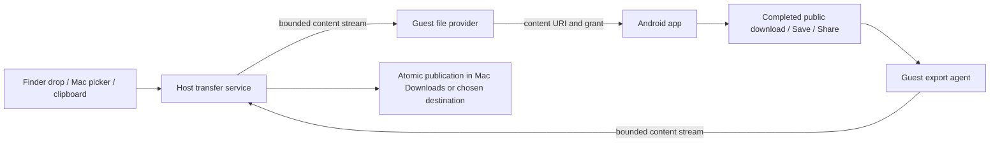

# Host files, downloads and clipboard integration

Date: 2026-11-07. Initial audit: `cf1ced8`. Status: implemented Developer-image bridge; partial unlocked native acceptance recorded below.

## Implemented behavior

The implementation includes window-owned asynchronous native Open/Save panels; Finder file-path drops delivered through the receiving app's Share contract; a private DocumentsProvider with stable IDs and URI grants; text, image and file clipboard transfers; and a supervisor-owned download exporter. No host directory is mounted or configured in Android.

- Standard `GET_CONTENT`, `OPEN_DOCUMENT`, `CREATE_DOCUMENT`, image/video `ACTION_PICK` and system `PICK_IMAGES` resolve to the original privileged GlidePod picker on the pinned Android 17 image. Requests on display 0 forward to an existing Android system picker. A rootless Personal image still needs equivalent image integration.
- The system helper is installed in a stopped instance clone, verified after boot, and promoted through a recoverable journal. Userdata is preserved. Original DocumentsUI/photo-picker packages remain enabled. APK and image hashes bind the installation record to this build.
- Imports are immutable copies. Persistent document grants survive an app restart. Save returns a writable URI before bytes are available; proxy descriptors enforce write limits and a storage reserve, then publish a completed revision on close. Saves and later revisions preserve existing Mac files with numbered filenames; live bidirectional editing is not provided.
- The worker polls successful public DownloadManager rows and published, non-trashed MediaStore Downloads, excludes private destinations, deduplicates the same underlying file, and copies to the native Mac Downloads location. The Developer adapter needs internal root for read-only DownloadProvider visibility; an ordinary privileged APK does not gain its signature-only permission. Raw direct writes without a publication contract remain unsupported.
- Publication verifies size and SHA-256, flushes data, uses a no-clobber hard link, and records completion before acknowledgement. Recovery recognizes a previously published inode. Removing a completed Mac copy does not cause it to reappear. A failed item does not block unrelated exports. Progress/errors are retained in `file-export-status.json`; app windows expose the last saved file through Finder.
- The default IME accesses the real Android clipboard. Native change counts, Android versions, origin metadata, a global coordinator and focus checks reject obsolete results. Copy/Cut use normal editor actions; Paste uses `commitContent` for advertised rich MIME types and normal paste otherwise. Revoked URI data is treated as unavailable and does not clear a valid Mac clipboard. Sensitive markers are carried where supported.
- Each file is limited to 64 GiB, each selection to 64 items, active picker requests to 16, and the provider index/download enumeration to 4096 items. Android retains a 512 MiB reserve. Clipboard snapshots are separate from persistent documents and expire after supersession plus a one-hour grace period; the current clipboard remains pinned. Persistent imported documents remain available until explicitly deleted in Android Files.

Source adapters: [`host_files.rs`](../../crates/glidepod-ui/src/host_files.rs), [`files.rs`](../../crates/glidepod-runtime/src/files.rs), [`host_files_setup.rs`](../../crates/glidepod-runtime/src/host_files_setup.rs), [`files.m`](../../crates/glidepod-macos/src/files.m), [`android/files`](../../android/files) and the default IME clipboard provider. The original proposal below records the wider acceptance matrix.

### Current acceptance boundary

The original unprivileged file fixture exercises activity results, URI reads and persistence, deferred saves, publication and private Share exports. Rust tests cover collision preservation, interrupted transfers, checksum rejection and promotion rollback. Local raw results are in `evidence/host-files-2026-11-07/`; the validation record there identifies exact passed scenarios.

The macOS development bundle can be built and launched. The initial locked session reported `CGSSessionScreenIsLocked=1` and `cgWindowNotFound`; guest tests did not certify Finder drag or native panel/keyboard interaction. The later unlocked-session results below qualify a subset of native behavior. Photos-library selection and promised-file drops remain follow-ups; filesystem images use the native file panel. Custom in-app galleries, arbitrary views without Share/paste support, camera capture, directory selection and rootless image integration are not generalized by this implementation. Large-file limits and minimum macOS versions still need scale/platform qualification.

### Validation on 2026-11-07

- `cargo test --workspace --locked`: 71 passed, 9 environment-dependent tests ignored by default. `cargo clippy --workspace --all-targets --locked -- -D warnings` and the workspace build passed. The existing `block` and `proc-macro-error2` dependencies emit Rust future-compatibility notices.
- `real_file_bridge_contracts`: passed in the disposable pinned Android 17 instance. Besides the scenarios listed in its raw report, the executed test includes a real public HTTPS DownloadManager download, exclusion of a private DownloadManager destination, preservation of the Android original after a host edit, actual PNG `commitContent` insertion, ordinary editor copy/paste, and an app-private attachment exported through an explicit Share grant.
- `real_rich_clipboard`: passed separately. `real_automatic_download_export`: passed with the normal supervisor owning the exporter, exact bytes appearing in the native Mac Downloads location, and no recreation after the test copy was removed.
- `real_focus_lease_routing`: passed after the clipboard integration. It checks two guest windows, Unicode, stale input rejection, held keys/controllers, touch cancellation and rapid focus transfers. It does not simulate native physical input.
- A real bridge update in a stopped instance clone, followed by promotion and reboot, preserved both the fixture's private sentinel and its persisted document grant. Two unit tests also cover interrupted and committed promotion recovery.
- `tools/package-dev.py --skip-build` produced `dist/GlidePod.app`; ad-hoc signing and `codesign --verify --deep --strict` passed. No release, global installation or publication was performed. The disposable test VM was stopped afterward.

Run guest tests only against a disposable store under `.cache`, with the original fixture APKs installed. Use `GLIDEPOD_TEST_STORE=<absolute disposable store> cargo test -p glidepod-runtime <test name> -- --ignored --nocapture`; the focus test belongs to `glidepod-ui`. The full contract test uses its own exporter and must run without the supervisor's automatic exporter competing for the same journal. The automatic-export test specifically requires the normal supervisor. Local evidence and build logs are indexed by `evidence/host-files-2026-11-07/validation.json`.

## Experience and failure review, 2026-11-07

The follow-up review fixes concrete failures rather than treating the first happy-path pass as complete acceptance:

| Failure or friction | Final behavior | Regression evidence |
| --- | --- | --- |
| An import failure left the picker waiting without a usable retry | Keep the original request; show Choose Again and Cancel; validate the complete selection before copying; reclaim unoffered imports after failure | `real_file_failure_recovery`: failed batch, same-request retry, obsolete-result rejection |
| Clipboard or drop cleanup could delete data after an acknowledgement was lost | Mark content as offered before handing out the URI. Automatic rollback cannot delete offered documents. Uncertain clipboard candidates remain readable until a confirmed later clipboard update | Delivered-URI rollback assertion in `real_file_bridge_contracts`; cancelled pre-publication clipboard rollback in the failure test |
| Saving replaced bytes before the metadata transaction committed | Publish an immutable revision, sync it, verify the AtomicFile metadata commit, then retire the previous revision. Serialize metadata writers/readers. Failed writes retain the last committed bytes and surface a retryable error | Injected `.json.new` commit failure, seekable/append writes, oversized-write rejection, subsequent recovery and export |
| The Mac-selected name was ignored; hidden/long names changed or failed on collision | Preserve the chosen filename, including `.env`; keep numbered collision names within the filesystem byte limit without splitting Unicode | Guest filename assertion and `selected_hidden_names_are_preserved_and_long_collisions_fit_the_filesystem` |
| Quick repeated paste acknowledgements overwrote one another | Queue each accepted paste, retain its focus lease, and remove stale operations on a focus change | `real_file_worker_does_not_retain_closed_window` plus existing two-window focus regression |
| A bulk worker kept a closed Android app window alive | Workers retain guest identity without retaining the window's task/display lease. Recheck a drop target after transferring. Remove the fixed five-minute picker expiry that could interrupt a valid transfer | Closed-window ownership regression; complete guest picker/drop contract |
| A later cancellation could overwrite an already queued picker result | Preserve the queued completion and defer cancellation until it can be accepted. A failed chooser is resolved before opening another chooser in the same window | Queued-result regression in the file-worker test |
| JPEG clipboard data was not exposed as a Mac bitmap; clearing left a false unsupported format | Normalize supported images to PNG with byte/pixel limits; preserve the previous clipboard on invalid input; clear without leaving an origin-only representation; recheck native revision after image conversion | `tools/check-files-native.py`: real AppKit adapter on a private pasteboard; no general clipboard access |
| Clipboard cleanup counted age from import rather than supersession | Pin the current clipboard; start the grace period when it is replaced; keep original filenames in separate per-item cache directories | `clipboard_retention_starts_when_superseded_and_preserves_original_names` |
| AndroidX's platform photo maximum could exceed the bridge limit and cancel immediately | Clamp to a valid selection of up to 64 items. Enforce the selection maximum before the native panel closes | Guest `PICK_IMAGES` request with maximum 150 resolves with maximum 64; native panel delegate compiled, interaction still pending |
| Completed exports could leave a hidden partial after a crash; concurrent exporters could collide | Reconcile and unlink only the owned staging link; keep user edits intact; serialize export cycles with a store lock | Completed-receipt recovery unit test and automatic-export integration test |

App windows now expose sending/preparing state. Transfer failures have separate state from input errors, and background error messages clear after recovery. Share receiver support is checked before importing a drop. Completed save/share copies can be explicitly deleted through Android Files; corrupt document metadata is preserved and reported without blocking unrelated documents.

Local evidence is in `evidence/host-files-review-2026-11-07/`, indexed by `validation.json`. At this review stage the ordinary workspace suite had 74 passing tests and 11 opt-in tests skipped by default; relevant guest tests were run separately. Clippy ran with `-D warnings`. Android helper compilation and the development app's ad-hoc signature were also checked. The submission checks below supersede these counts.

The isolated native test verifies actual AppKit pasteboard behavior while the screen is locked. It does **not** certify Finder dragging, panel focus/layout, or physical keyboard interaction. Those still require an unlocked session. Full-size 64 GiB transfers, physical disk exhaustion, OS access-denial flows, promised files, Photos-library integration and rootless images remain qualification work. [Proxy file descriptors](https://developer.android.com/reference/android/os/ProxyFileDescriptorCallback) report close and IO failures; they cannot generally identify an application's semantic abort after otherwise successful writes. The host therefore preserves independent copies and the provider's last committed revision, without claiming arbitrary app-level completion semantics.

## Submission review, 2026-11-07

The full pending source batch was reviewed before submission, including the native file/clipboard adapter, Android URI permissions, download publication/recovery, startup promotion, per-window lifecycle and trackpad integration. Two additional races were corrected:

- The private provider now marks imports as offered before posting a picker completion to Android's main thread or issuing a delivery token. A lost transport reply can no longer let host rollback delete a queued result before the receiving Activity runs. The real guest contract also creates an unstarted delivery, attempts rollback and checks that its retained contents remain readable.
- A later paste/drop failure retains an earlier failed picker's pending retry. A regression test models both failures arriving before the next UI poll, preserving Choose Again/Cancel.

Final submission checks passed:

- Workspace formatting, strict Clippy, build, and 79 ordinary tests. The default runner skipped 12 opt-in tests; eight relevant guest tests were then run explicitly.
- The eight real Android checks cover file contracts, transfer failure/recovery, rich clipboard, independent display/input, focus leases, closed-window ownership, touch/trackpad delivery, and automatic download export. The final review used the registered Android 17 Developer image with software rendering; earlier Metal input evidence remains documented in [the input record](18-touch-and-trackpad-input.md).
- Normal startup promoted the updated system helper. Its installation record matches the current APK hash. The fixture's private sentinel and persisted document URI returned identical hashes before and after the upgrade. Automatic exports used the native Mac Downloads destination and did not recreate a deleted copy.
- Both native adapter checks passed: isolated AppKit pasteboard behavior and synthetic in-process trackpad events. Android helpers compiled, the development bundle was rebuilt, and its ad-hoc signature passed strict verification. The dependency license inventory was regenerated; no resolved dependency or license-inventory change was introduced.

Final review logs and reports are local-only under `evidence/final-review-20261107/`; binaries, VM data and raw traces are excluded from the source submission.

Native physical Finder, panel and trackpad acceptance remains separate from source submission. The existing locked-session limitation is not removed by the automated tests.

## Unlocked native acceptance, 2026-11-07

The user unlocked the desktop. The ad-hoc development bundle was exercised on Mac17,14, macOS 27.2 (26B123), against the disposable Android 17 Developer store with software rendering. Native UI observations and Android fixture assertions were paired; no private user files were selected.

- A real Android `OPEN_DOCUMENT` request presented a window-owned `NSOpenPanel`. Selecting the synthetic `native-选择.txt` returned its original name, a persisted URI grant and the exact SHA-256 of the Mac file.
- Clicking the native Cancel button initially left Android waiting and displayed “Too many selected files.” The native completion boxed a C comparison as JSON number 0/1, while Rust expected a boolean. Explicit `@YES`/`@NO` now preserve the cancellation contract. The rebuilt app returned Android `RESULT_CANCELED`; the native regression test covers Cancel, Abort and OK through the actual JSON boundary and verifies single consumption.
- A real `CREATE_DOCUMENT` request presented `NSSavePanel`. The selected Unicode filename was preserved. Android received an unwritten URI before publication; after the fixture wrote and closed it, the exact contents appeared in the selected Mac directory.
- A Chinese text paste reached the Android editor. ASCII text entry and Select All also reached it. Android Copy followed by native Edit > Select All / Paste placed the exact copied text into the Save panel's filename field. The application now exposes AppKit's standard Cut/Copy/Paste/Select All menu actions, with matching Android-window handlers and the existing focus lease checks.

The menu actions were verified directly. Simulated shortcuts in the native Save field did not consistently act on that field, so physical shortcut and IME behavior is not certified. The automation paste helper restores the previous host clipboard immediately; asynchronous paste can observe that restored value, so temporary tool clipboard contents are not a deterministic manual-paste substitute. Closing an Android task returned to the management window, but subsequent coordinate actions encountered the tool's `noWindowsAvailable` error until the test process was restarted. Background-directed test-window clicks produced no new Android events; this is not evidence of successful physical input or a reason to relax active-window ownership.

The updated native regression check, 79 ordinary workspace tests, strict Clippy, workspace build, development packaging and signature verification passed. Raw fixture assertions are local-only in `evidence/native-acceptance-20261107/`. Physical Finder dragging, hardware controllers and broader resize/focus behavior remain separate acceptance items. The subsequent [physical trackpad session](18-touch-and-trackpad-input.md#physical-trackpad-acceptance-2026-11-08) verified tap, scroll, pinch in/out and rotation delivery.

## Product contract

File integration must work without asking users to configure shared directories. Host and guest exchange specific file contents through a managed transfer service. Android retains its normal filesystem, application data, file ownership and storage APIs.

- Drag a Finder file into an Android app window to deliver it to that app when it supports an appropriate receiving action.
- An app's supported file/image selection request opens the native Mac chooser, with the requested types and selection count. The app receives ordinary Android content URIs.
- Completed, user-visible Android downloads appear automatically in the Mac's normal Downloads location. Resolve that location with the macOS API; no shared mount or folder-mapping setup is involved.
- App Share and Save/Export actions can deliver an individual file to the Mac, including files that live in app-private storage when the app grants access.
- Text copied through Android menus, long press or keyboard shortcuts participates in the Mac clipboard. Images and files use the same transfer service with type-aware delivery.

For downloads, synchronization means delivery of a completed independent copy. Deleting, renaming or editing that Mac copy does not modify Android's original. Ordinary uploads do not grant write access to the original Mac file. Live bidirectional editing requires a separate, explicit document contract and is outside this first implementation.

Normal operating-system access prompts may still occur. They must not turn into a shared-directory configuration flow. If macOS denies Downloads access, keep the Android download intact and retain a retryable export with a concise action to resolve access.

## Original source audit at cf1ced8

| Capability | Source finding | Actual boundary |
| --- | --- | --- |
| Finder drop into management center | [`views.rs`](../../crates/glidepod-ui/src/views.rs), `glidepod-center.on_drop` | Inspects the first dropped path as an APK. This is not an app file-upload bridge. |
| Finder drop into Android window | [`app_window.rs`](../../crates/glidepod-ui/src/app_window.rs) | No external-file drop handler. Android input carries keys, touch, mouse and gamepad events, not file payloads. |
| Native file chooser | [`main.rs`](../../crates/glidepod-ui/src/main.rs), `choose_apk`, `choose_runtime`, `choose_gpu`, `choose_image` | Management operations only. `choose_image` selects a runtime image manifest, not a photo. |
| Mac text paste | `AndroidWindow::key_down` → `Action::Text` → [`AppWindow::text`](../../crates/glidepod-runtime/src/display.rs) | Command-V extracts clipboard text and commits it into the focused Android editor. It does not populate Android's clipboard. Input is limited to 16,384 UTF-8 bytes. |
| Android text copy/cut | [`MacInput.java`](../../android/input/src/dev/glidepod/input/MacInput.java) → `Update::Clipboard` | Reads selected text from the current editor; cut replaces that selection with empty text. It does not invoke normal Android clipboard copy/cut. Non-editor selection and app-specific Copy actions are not bridged. |
| Image/file clipboard or automatic text sharing | Same input files | No `ClipboardManager` synchronization, URI clipboard provider or change tracking. |
| Guest file transfer | [`adb.rs`](../../crates/glidepod-runtime/src/adb.rs), `Adb::push` | Streams host files to `/data/local/tmp/glidepod/`, with a 2 GiB limit. No general guest-to-host transfer or user-document provider. Shell-owned installer staging is not an app-readable document service. |
| Android download export | Android helpers and runtime | No DownloadProvider/MediaStore observer, durable export queue or host publisher. [`download.m`](../../crates/glidepod-macos/src/download.m) downloads HTTPS runtime packages on the host; it does not export Android downloads. |

The pinned GPUI 0.2.2 source already implements macOS `NSOpenPanel`, external file-path drops, and text/image pasteboard entries. Its `PathPromptOptions` lacks MIME/UTType filters and an owning-window parameter; its clipboard entry enum has no file-URL entry. Add small native adapters for these missing features rather than assuming the existing abstraction provides them. Finder file URLs are the first drop target; promised files from Photos or other applications need separate materialization support and acceptance tests.

Existing guest tests exercise Unicode text and selected-text round trips. They do not establish system clipboard sharing, native file selection from an Android app, file dragging, or Android download export.

## One transfer service, no shared filesystem

The Rust runtime owns transfer authorization, lifecycle and recovery. A guest provider owns Android URI access and temporary document storage. The macOS adapter owns chooser windows, pasteboard types and destination publication. Reuse the private, epoch-scoped transport for the first prototype, but keep bulk transfer workers separate from frame/input workers and avoid base64 file payloads in shell commands or JSON.

Each request binds an operation ID to the profile, Android user, guest instance, VM epoch, originating task/display, caller identity, MIME types and operation kind. Derive the caller and task from Android, not an untrusted package-name extra. A host picker is attached to the originating Mac window; switching to another app never retargets a pending selection.

Open a host-selected file once and transfer from that authorized descriptor. Guest requests contain opaque transfer IDs, not arbitrary host paths. Store imported content privately in the guest provider, expose metadata and seekable descriptors, and grant only the rights required for the operation. A pathname in `/data/local/tmp` or a `file://` URI is not an acceptable return value.

Temporary transfer files are internal implementation storage, not user-managed shared directories. File lists, byte streams and queues must be bounded, cancellation must close descriptors, and workers must yield to input/rendering. Start with two concurrent bulk transfers and bounded chunks; measure buffer high-water marks and performance before selecting final limits. The existing 2 GiB installer-transfer limit must be addressed explicitly for large videos and archives.

### Preserve app data and document lifetimes

- Keep existing app-private directories, databases, credentials, permissions, mount layout and SELinux behavior unchanged. Do not relocate app storage or redirect the Android Downloads path to a Mac filesystem.
- Importing a Mac file creates a guest-owned snapshot. The Android app can continue reading it if the host file moves or the Mac disconnects.
- `ACTION_GET_CONTENT`, drag/share delivery and `ACTION_OPEN_DOCUMENT` have different lifetime contracts. Do not expire every file when its picker closes or the Mac window loses focus.
- For `ACTION_OPEN_DOCUMENT`, stable document IDs and persisted grants must remain valid across app/VM restarts until explicitly revoked or deleted. Track these references separately from temporary transfers; do not use VM epoch as the durable document identity.
- A failed import publishes no URI to incomplete data. A failed export never removes or rewrites the Android source. Cache cleanup only removes service-owned data whose access contract has ended.

Android's supported extension point is a [DocumentsProvider](https://developer.android.com/guide/topics/providers/create-document-provider). URI permissions and a document's readable descriptor must be implemented alongside the native chooser.

## File selection and drag/drop

| App entry point | Proposed integration | Compatibility boundary |
| --- | --- | --- |
| `ACTION_GET_CONTENT`, `ACTION_OPEN_DOCUMENT` | Guest picker adapter requests a Mac `NSOpenPanel`; transfer selected contents; return URI/ClipData, MIME metadata and appropriate grants | A provider adds a source to Android's picker; it does not automatically replace that picker with a Mac panel. Qualify routing in the exact guest image. |
| `ACTION_PICK_IMAGES` / AndroidX visual-media contracts | Integrate the guest's system photo picker with the same request/result service | AndroidX prefers the system picker and has system-only fallback resolution. Installing an ordinary intent handler does not establish universal interception. |
| Legacy `ACTION_PICK` | Support verified image/video MIME and URI contracts individually | This intent also serves unrelated data types. Do not intercept every `ACTION_PICK`. |
| App's own gallery/file browser | Offer selected-file import; optionally publish user-selected images through MediaStore so that a compatible gallery can discover them | A custom in-process screen cannot generally be replaced through intent registration. Respect the app's media permissions and supported formats. |
| WebView/HTML file upload | Cover the Android picker intent actually launched by the embedding app | `WebChromeClient` handling, custom activities and camera capture can differ. Test real browser/WebView paths. |
| Finder drop | Create guest content URIs, then deliver through a supported Android drag/content or targeted share action | Arbitrary Android views are not guaranteed to accept drops. Share may open another activity and is not equivalent to inserting at the pointer. |

For the seamless default experience, qualify guest-image integration of DocumentsUI and the system photo picker. A separately installed provider is a useful compatibility path, but must not be reported as completing native picker replacement. Pin guest/module versions and preserve the original activity-result flow, cancellation and back behavior. Do not replace or re-sign third-party applications.

The distinction follows Android's [photo picker contracts](https://developer.android.com/training/data-storage/shared/photo-picker) and the inspected [AndroidX resolver implementation](https://android.googlesource.com/platform/frameworks/support/+/91a12edbc83943787f4e71fd3b9a74e3cbed8022/activity/activity/src/main/java/androidx/activity/result/contract/ActivityResultContracts.kt), including `MATCH_SYSTEM_ONLY` for fallback pickers.

Use [NSOpenPanel](https://developer.apple.com/documentation/appkit/nsopenpanel) for filesystem images and other files, with UTType filters, multiselect and cancellation. A Mac Photos-library source is a separate [PhotosPicker](https://developer.apple.com/documentation/photosui/photospicker) adapter that materializes the selected assets. Neither source implies automatic access to the whole photo library. Preserve format/orientation; make any compatibility conversion deliberate and verify it.

For a real Android drag, provide content URI grants and a valid guest drag lifecycle. Mouse injection alone cannot carry file data. Android documents [cross-app drag permissions](https://developer.android.com/develop/ui/views/touch-and-input/drag-drop/multi-window); supported editors may instead accept [IME content commits](https://developer.android.com/reference/android/view/inputmethod/InputConnection#commitContent(android.view.inputmethod.InputContentInfo,%20int,%20android.os.Bundle)). Do not treat an accepted commit as proof the app finished reading or uploading the content.

### Task and focus prerequisite

[`Input.java`](../../android/bridge/src/dev/glidepod/bridge/Input.java) currently reacquires focus only if a task's **top** activity belongs to the original app package. `MacInput` also requires the focused editor package to match the original package. A system picker or bridge activity can be a different package, so focus restoration or typing into that picker can be rejected. This is a source-derived integration risk, not a reproduced failure in this audit.

Add an explicit child-activity/request relationship for the owned task and display. Keep the original app as the window owner while the authorized picker is active. Restore focus when its result returns; cancel the request on task/window destruction. Do not solve this by allowing any package on any display or by removing package-scoped task cleanup.

## Automatic Android downloads on the Mac

### Detection must have system visibility

A normal helper APK cannot be assumed to observe or read every app's downloads. Android requires SAF access for other apps' entries in [MediaStore.Downloads](https://developer.android.com/training/data-storage/shared/media). In AOSP, [DownloadProvider](https://android.googlesource.com/platform/packages/providers/DownloadProvider/+/refs/heads/main/src/com/android/providers/downloads/DownloadProvider.java) limits ordinary queries by UID; [DownloadInfo](https://android.googlesource.com/platform/packages/providers/DownloadProvider/+/refs/heads/main/src/com/android/providers/downloads/DownloadInfo.java) sends completion broadcasts to the requesting package. A generic `ACTION_DOWNLOAD_COMPLETE` receiver is insufficient.

The production design therefore needs a narrowly scoped, image-integrated export agent with verified provider permissions and SELinux access, or explicit callbacks from the image's DownloadProvider/MediaProvider. Reuse root/shell only as a Developer-image feasibility adapter; that does not prove rootless Personal-image support. Pin and test the actual guest providers before selecting the integration point.

| Source | Readiness and delivery rule |
| --- | --- |
| DownloadManager public, user-visible download | Reconcile provider state and require successful completion, readable source and validated size/version. Completion events are wakeups, not authority. Exclude private destinations and non-user download resources even if the agent can see their metadata. |
| Public content published through MediaStore | Observe relevant publications, require `IS_PENDING=0`, not trashed, and verify the selected version. Include downloads and explicitly saved/exported user media; do not export all media rows or app caches indiscriminately. |
| Direct file writes to public Downloads | Evaluate a guest-side write/rename completion adapter. File appearance, stable size and a single close event do not prove that an arbitrary writer has finished. Without a reliable readiness signal, retain this as a coverage gap or require the app's Share/Export action. |
| App-private attachment or document | The app's Share/Save/Export provides a URI and permission to read an individual item. Register a compact “Save to Mac” share destination. Do not crawl `/data/data`, `/data/user`, `Android/data`, encrypted stores or private caches. |
| App-private offline video/game assets | Leave them in Android. An application's own supported export is needed to produce a normal user file. No general automatic export guarantee. |

`IS_PENDING` is a publication signal for cooperative writers, not a universal download-completion detector. Its documented semantics are in [MediaColumns](https://developer.android.com/reference/android/provider/MediaStore.MediaColumns#IS_PENDING). A guest service must combine source-specific completion with a coherent source version; merely hashing a concurrently changing file does not create a consistent snapshot.

### Transaction and recovery

1. Record the completed source's durable identity and version in an export journal: guest instance/profile/user, provider/database version, source ID and generation. Use a VM epoch only for live-session authorization. Deduplicate DownloadManager and MediaStore representations of the same item where their relationship is known.
2. Open an authorized read descriptor promptly. Capture a stable snapshot when the provider cannot guarantee an immutable version. If the source changes or disappears, retry that version or report a specific failure; never publish an inconsistent file.
3. Stream into a hidden partial file on the Mac destination filesystem, with bounded memory, cancellation, byte counts and a checksum. Never load the complete download into RAM. Resolve cloud-backed paths and access failures explicitly.
4. Verify completion and source version, flush data, and publish through a no-clobber atomic operation. Sanitize filenames, reject traversal/symlink escapes, and resolve collisions as normal macOS filenames such as `report (2).pdf`.
5. Persist completion before acknowledging it to the guest. Recovery must reconcile the narrow crash window between publication and journal completion using the transfer's durable receipt, so retries do not create duplicates. Only then show “Saved to Downloads” with “Show in Finder.”
6. Keep the Android original and its database references intact. Mac edits/deletes do not propagate back; a later Android revision gets a new export rather than overwriting a user-edited Mac file. Deleting a completed Mac export must not cause it to reappear on every reconciliation.

Use a bounded persistent queue and reconcile after agent/host restart, missed events and VM suspension. Check MediaStore's database version before trusting generation numbers; its [generation APIs](https://developer.android.com/reference/kotlin/android/provider/MediaStore) describe why timestamps alone are insufficient. On first activation, establish a baseline without unexpectedly dumping all historical Android storage into Downloads; provide a separate action to recover older user downloads if needed.

Disk-full, access denial and host shutdown leave the original Android download successful and usable. Report host-export progress separately from Android's own download status. Do not rewrite DownloadManager's result to represent a Mac publication failure.

### Save/export integration

For `ACTION_CREATE_DOCUMENT`, a native Save panel can reserve the destination while the guest provider returns a writable staging URI to the app. The app must receive that URI **before** it can write. Publish to the host only after the provider-controlled write completes successfully, with an explicit policy for multiple opens, failed closes and later rewrites. Do not deadlock by waiting for exported bytes before returning the picker result, and do not report “Saved on Mac” merely because the user chose a filename.

For `ACTION_SEND`/`ACTION_SEND_MULTIPLE`, accept and validate the app-granted streams and export their content through the same queue. Use persistable grants only when actually offered; otherwise copy into provider-owned staging while the transient grant remains valid. These actions cover app-private files without exposing their containing directory.

## Shared clipboard

Implement real `NSPasteboard` ↔ Android `ClipboardManager` synchronization. Extend the existing default IME rather than relying on an unrelated background helper: [Android 10 and later restrict clipboard reads to the focused app or default IME](https://developer.android.com/about/versions/10/privacy/changes#clipboard-data). Qualify current-guest behavior when no editor is active and when the user changes the IME; a default-IME exemption is not proof that the existing IME service stays alive in every state.

- Text sharing should work through normal Android Copy/Cut/Paste, long press, and Mac keyboard shortcuts. Keep input composition distinct from paste. Synchronize on relevant user interaction/focus transitions, with bounded change detection while managed windows are active; recheck at paste time.
- Use origin/revision markers and host pasteboard change counts to suppress loops. Carry the initiating lease/session and observed host revision through asynchronous results; reject late responses that would overwrite a newer Mac copy. The current `Update::Clipboard(String)` lacks this metadata.
- Android clipboard contents are normally shared within an Android user. Do not promise package isolation from an IME listener alone. Bind host synchronization to the active profile/user and defined foreground interaction policy; test clipboard source attribution separately if required.
- Images and file URLs are typed data, not strings containing host paths. Use temporary provider URIs and normal read grants on Android; materialize guest URI content into host-owned data/files for Mac paste. Advertised MIME types and editor support determine whether content can be inserted.
- Preserve sensitive-content metadata where supported, omit content from diagnostics and do not retain clipboard history. Android's [sensitive marker](https://developer.android.com/develop/ui/views/touch-and-input/copy-paste#SensitiveContent) hides previews; it is not an access-control mechanism. Respect macOS pasteboard access behavior.

## Delivery sequence and acceptance

| Stage | Deliverable | Required evidence |
| --- | --- | --- |
| 1. Guest integration gates | Original fixture app for each picker contract, downloads via DownloadManager/MediaStore/direct writer, private export, and system clipboard | Resolve actual activities/providers and required privileges in the pinned image; prove caller/task/result ownership, default-IME coverage and rootless-image requirements. Record unsupported cases explicitly. |
| 2. Transfer foundation | Private URI provider, streaming in both directions, durable exports, atomic host publication | Byte-for-byte synthetic files; empty/Unicode/duplicate names; random access; large files and disk-full; disconnect/restart; cancellation; URI grants and persisted-open behavior. |
| 3. Everyday integration | Text clipboard, Mac file selection and completed public downloads to Mac Downloads | Two apps/windows cannot receive each other's picker result; long-press copy and menu paste work; ordinary downloads appear once, remain readable inside Android, and survive Mac export failure. |
| 4. Rich-content coverage | Photo picker, Photos source, image/file clipboard, Finder drop, Save to Mac | System and custom picker matrix, supported/unsupported drop targets, transient URI lifetimes, multiselect order and MIME checks, actual content insertion/export. |
| 5. Native acceptance | Unlocked-session Mac workflow through the packaged app | Finder drag, native Open/Save panels, keyboard/menu clipboard, Downloads/Finder result, OS access denial and recovery. Guest tests alone do not pass this stage. |

Protect app-data correctness with original fixtures that retain database records and URI references to their downloaded files. Verify the originals still open and hash correctly after host export, host modification/deletion, guest reboot, app restart and export failure. Verify persistent document grants survive supported restarts. Add concurrent downloads, same-name files, re-downloads, source rewrites, host edits and missed-event recovery; memory must remain bounded while two app windows render and receive input.

Likely implementation locations: `glidepod-macos` for chooser/pasteboard/export adapters; `glidepod-runtime` for transfers, grants and the export journal; `glidepod-ui` for window-bound requests and drop/progress UI; `android/input` for clipboard; a new `android/files` provider/agent and fixture; and pinned guest-image integration patches for system pickers/download visibility. Module names and guest hooks remain design choices until stage 1 proves them.

## Initial research evidence (before implementation)

The current checkout, pinned GPUI implementation, Android helpers and existing test contracts were inspected. Apple/Android documentation and AOSP/AndroidX source were consulted live. No user clipboard contents or personal files were read. No VM, native drag/drop, picker, file transfer or download synchronization scenario was executed in this audit. The work adds documentation only; feature implementation and acceptance remain pending.
