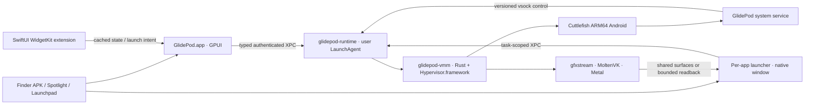
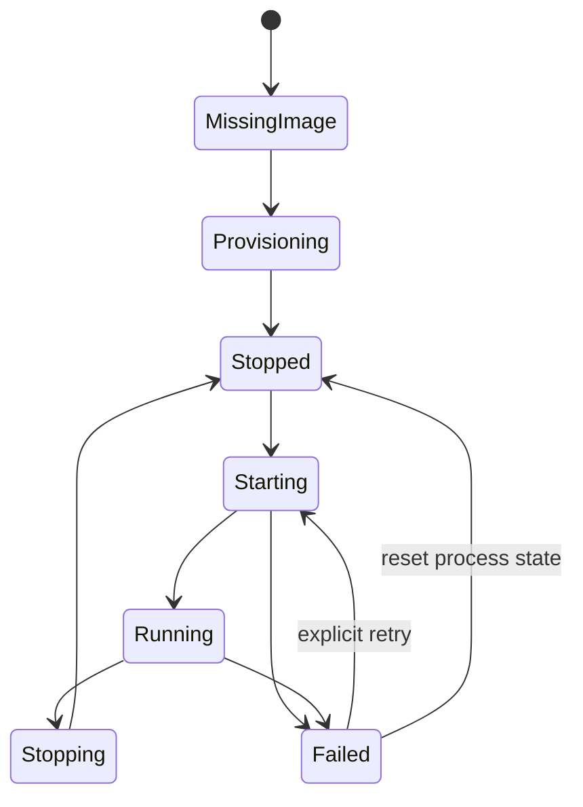

# Runtime and display architecture

This is a proposed implementation contract, not an existing API. The host is primarily Rust; Android integration uses platform APIs through a small Kotlin/Java service plus native Rust/C++ where required. Swift/Objective-C glue handles the macOS APIs for which it is the clearest integration, and SwiftUI is used only for WidgetKit.

## Processes and ownership



| Component | Responsibility | Authority |
| --- | --- | --- |
| `glidepod-ui` | Library, installer, VM settings, diagnostics, widget catalog | Requests typed operations; no raw guest shell in normal UI flows |
| `glidepod-runtime` | Persistent app/task registry, install queue, VM supervision, grants and shim registry | Same macOS user; owns per-instance credentials and durable transactions |
| `glidepod-vmm` | Boot, vCPUs, RAM, Virtio, guest clocks and renderer | Hypervisor entitlement; bounded device parsers; no macOS root |
| `glidepod-window` | One application identity per shim process; one or more native windows | Only registered app/profile tasks and their surfaces/input |
| `glidepod-macos` | AppKit, XPC, Metal/IOSurface, TCC, notifications, file descriptors | Minimal Objective-C/Swift adapters with a narrow Rust interface |
| `GlidePodBridge` | Privileged guest tasks, display/input routing, package/widget events | Platform-signed system app or system service; explicit SELinux policy |
| Widget extension | Mac widget timelines and selected launch actions | Shared sanitized snapshot, no guest credentials or always-running VM loop |
| `glidepodctl` | Scriptable management and diagnostics | Authenticated same-user client; JSON stdout and opt-in verbose logs |

One VM serves all apps in one profile. The first version has one active profile at a time: Personal and optional Developer use separate data disks, credentials and roots. Profile switching stops the current VM with an explicit affected-app summary. Multiple concurrent profiles are a later memory-budget feature, not one VM per APK.

## Cuttlefish adaptation map

| Layer | Keep | Add or change |
| --- | --- | --- |
| Guest system and product | AOSP, Cuttlefish ARM64 device definition, PackageManager, ART, SurfaceFlinger | Reproducible `glidepod_cf_arm64` product, bridge service, per-image manifest |
| Boot/device contract | Cuttlefish kernel/HAL expectations | Mac boot assembly, DT/bootconfig, composite disk layout, AVB handling, console IDs, Virtio PCI/MMIO layout |
| Guest graphics | gfxstream Vulkan guest driver, ANGLE, gralloc and composer where compatible | Scanout lifecycle/resize, display identification and frame export; targeted composer changes if necessary |
| Activity/task policy | Android task and intent semantics | Stable task-to-window mapping, known system dialog placement, external launch reconciliation |
| Input | Android InputDispatcher and normal app events | Focus/display-targeted injection, text composition bridge, mouse capture and gamepad routing |
| Host tooling | Cuttlefish image build/fetch knowledge and Linux reference VM | Rust supervisor replaces Linux `cvd`, TAP setup, WebRTC viewer and Linux-only service orchestration |
| Integration | Android notifications, intents, media sessions and AppWidgetHost | Authenticated host bridge, host file-provider flow and permission broker |

A Linux ARM64 build machine builds Android. Mac CI builds Rust, GPUI, native adapters and source-built graphics libraries. Keep Cuttlefish manifest, VMM, gfxstream guest/host and image versions in one tested compatibility lock. Do not change the renderer independently of its guest protocol.

VMM bring-up must inventory block, serial, entropy, network, vsock, input, graphics and sound devices expected by the exact image, including unsupported peripheral HALs. Test host 16 KiB mapping alignment independently from guest 4/16 KiB page size, address overflow, queue lengths, DMA bounds, reset ordering, interrupts, timers and PSCI reboot. Use user-mode NAT first; inbound networking is off until explicitly configured.

## One Android task, one native window

1. A registered launcher sends `OpenApp(profile, package, component, request_id)`.
2. Runtime ensures one VM start, authenticates the guest bridge and replays any pending request once.
3. Bridge either locates a reusable task or allocates a display lease. Display 0 remains the control/system display. An initial pool of four app displays is a resource policy, not an Android API limit.
4. A platform-privileged launch uses display options and validates the resulting task placement. Private/public/trusted display rules must match the image; an arbitrary third-party virtual display cannot launch every app. [Android launch policy](https://source.android.com/docs/core/display/multi_display/activity-launch).
5. Runtime returns a `WindowLease`; the shim opens an `NSWindow` and binds a frame stream. Task creation and display allocation have rollback paths.
6. Android task events update the title, icon, focus, back availability, orientation and resize policy. A package can own multiple tasks; the mapping is never keyed only by package name.
7. External intents, child activities, chooser dialogs, permission dialogs and notification actions preserve the initiating task/display when allowed. A system or cross-app activity either becomes a separately owned window or a clearly labeled system sheet. It must not silently appear on the hidden display.

Prefer display hotplug/scanout-backed output first because it preserves Android composition. Keep a privileged virtual-display path as an experiment for larger task counts. `MediaProjection`, framebuffer cropping, screen recording and WebRTC are not the normal local presentation path. Non-resizable apps get a fixed aspect ratio with letterboxing and a visible orientation control. Do not force desktop mode on every app.

**Window close:** request task removal, then release its display after task confirmation. Background Android services may continue; closing a window does not automatically force-stop the package. **Quit app:** close all its tasks and offer an explicit stop-background-app action. **Force stop:** dedicated management command. This distinction prevents media/background jobs from being killed by ordinary Mac window behavior.

## Resize, scaling, focus and text

- Keep host points, Android dp and framebuffer pixels separate. Start at 1 dp per Mac point; derive guest density from the chosen render scale (2 pixels per dp corresponds to 320 dpi).
- During live resize, scale the last completed frame. Commit debounced display configuration with a new generation; acknowledge it before routing input in the new coordinate space. Never reinterpret an old frame using new bounds.
- Track `(profile, vm_epoch, display_id, display_generation, task_id, window_id)` through input and presentation. Include rotation, letterbox inset and scale in the transform.
- Only the foreground window receives keyboard/gamepad capture. Pointer release and synthesized key/button-up events run on focus loss, disconnect, VM stop and host sleep.
- Implement `NSTextInputClient` composition through a guest IME protocol. Distinguish marked text, committed text, selection, deletion and physical game keys. Test Chinese/Japanese composition, emoji, dead keys and password fields; clipboard paste is not an IME implementation.
- Native title bars, window controls, Spaces, full-screen and accessibility belong to AppKit/GPUI. Expose Android accessibility semantics through a separate bridge with password redaction; a texture alone has no VoiceOver tree.

## Draft protocol

Use XPC for same-user host processes and framed Protobuf messages over vsock for the guest. Avoid general shell-string APIs. An authenticated hello negotiates protocol major/minor, image ID and capabilities. A version mismatch yields an actionable update/recovery state.

```text
Envelope { protocol_major, protocol_minor, vm_epoch, request_id, deadline_ms }
OpenApp { profile_id, package_id, component?, launch_intent_token? }
WindowLease { task_id, display_id, display_generation, bounds_dp, capabilities }
ResizeDisplay { lease, logical_size, pixel_size, density_dpi, serial }
InputBatch { lease, focus_epoch, resize_serial, events[] }
SurfaceSet { lease, surface_generation, pixel_format, color_space, handles[] }
Present { lease, surface_generation, slot, frame_id, producer_fence, time_ns }
ReleaseFrame { lease, surface_generation, slot, frame_id, consumer_fence }
InstallSession { idempotency_key, source_fd, digest, selected_splits[] }
RootPolicy { profile_id, desired_mode, expires_at?, expected_state_version }
WidgetLease { provider_component, app_widget_id, display_lease }
```

Control messages carry no pixel arrays. Enforce payload limits, per-operation authorization, deadline/cancellation and monotonic state versions. Host XPC validates audit-token identity, user/session and signing requirement; a claimed role is insufficient. Guest bootstrap credentials are instance-specific and rotated on reset. App windows get scoped leases, not administrator credentials. Rooting the guest can compromise that guest's credentials; host authorization must still constrain every message.

On reconnect, send a complete snapshot plus event cursor; clients discard pre-epoch events. Reconcile installed packages and live tasks instead of blindly replaying an install or launch. Request IDs make duplicate delivery safe. Bound frame queues independently of the control channel so a slow window cannot block lifecycle operations.

## VM lifecycle and persistence



Keep `desired_state` and observed state separate. A lock and supervisor generation guarantee one VMM per active profile. Closing the management center leaves active tasks and media running. Default idle behavior stops Android after a configurable interval only when no visible apps, active audio, installs or opted-in live widgets need it; background execution policy is visible to the user.

Stop requests guest shutdown, drains package sessions, stops audio and input, waits for bounded acknowledgement, then offers force stop if required. A crash closes stale surface leases and preserves data; do not silently restart an endless crash loop. Renderer device loss suspends presentation and requests a controlled renderer/VM restart. Host sleep requires clock, audio and transport recovery; it is not a disk snapshot.

v0.1 supports start, graceful stop, restart, recovery and offline backups. Pause/save-state is hidden until vCPU/device/timer/GPU restoration is validated. GPU resources cannot be assumed serializable. Back up cold data disks or a proven guest-quiesced snapshot; an APFS clone of an actively written filesystem is not by itself a consistent Android backup.

Persist SQLite records for profiles, apps, tasks, shims, installs, policies and image versions. Store immutable images by hash, per-profile userdata separately, and disposable shader/log caches separately. Keep logs bounded. Runtime update replaces signed host components atomically; an image update snapshots stopped user data and has a rollback compatibility check. Data schema rollback may require restoring the matching data snapshot.

## Host protection

No App Store sandbox requirement does not remove TCC, Gatekeeper or guest isolation. Run as the logged-in user, keep ADB private and disabled by default, and never expose a root shell on a TCP port. Pass user-selected open file descriptors across XPC; do not grant the guest access to the home directory. File-sharing grants specify direction, path, lifetime and write access. Resolve paths without traversal/symlink escape and enforce limits on archives and Virtio memory mappings. Separate renderer process isolation is a later hardening goal if guest-memory ownership makes it too costly for the initial VMM.
