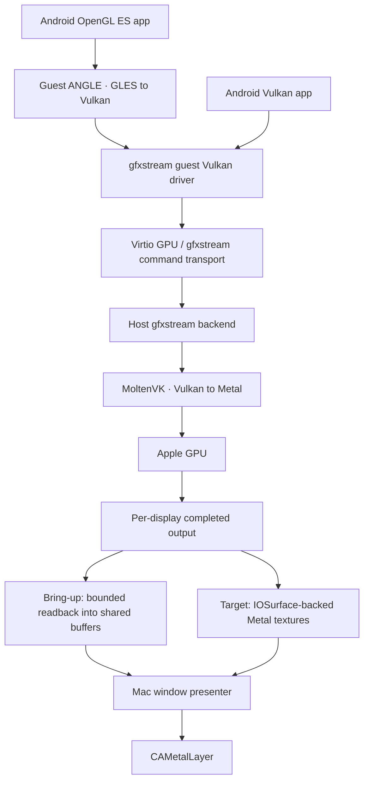

# Graphics, presentation and game compatibility

## Rendering pipeline

This uses the Mac's GPU via API translation, not PCI GPU passthrough. SurfaceFlinger still composes Android content; `hwcomposer.mode=client` is a useful initial compatibility configuration to evaluate. Hardware composition can be introduced after client composition is correct. Cuttlefish's documented gfxstream mode and [gfxstream's source](https://github.com/google/gfxstream) establish the transport foundation; the Mac backend build and display integration remain our work.

Choose guest ANGLE on Vulkan first because it gives GLES and native Vulkan a common downstream path. Host ANGLE on Metal is an alternate GLES experiment, not a second mandatory renderer in v0.1. Virgl's documented Cuttlefish path does not offer Vulkan; SwiftShader is the software recovery mode. Avoid a macOS OpenGL dependency as the main renderer.

## Reproducible graphics baseline

The inspected [Avo build script](https://github.com/nizwar/avo/blob/99153258763a9ccdf5d4c6de36bd631e4dd0dded/scripts/build-gfxstream.sh) pins gfxstream commit `ec3143b4ac345af198b3f5690bfc79c728128704`, Vulkan loader/headers and MoltenVK 1.4.0. This is an initial reproduction candidate, not an approved GlidePod dependency lock. Rebuild the entire graphics dependency closure from audited sources for the release baseline, record toolchains and licenses, and test against the selected guest driver. Do not depend on whatever Android Studio happens to have installed.

The [MoltenVK guide](https://github.com/KhronosGroup/MoltenVK/blob/main/Docs/MoltenVK_Runtime_UserGuide.md) describes portability enumeration and Metal interoperability extensions. Probe extensions on the exact build/device; negotiate only what the complete guest-to-host stack implements. Report Vulkan versions, feature structs, texture formats and limits consistently. Do not spoof `VK_EXT_provoking_vertex`, geometry shaders, protected memory or other features to make an application pass its startup checks. Unsupported rendering semantics need correct emulation or an honest incompatibility result.

## Presentation stages

**P0 — correctness path.** Use gfxstream's completed color-buffer readback into a bounded shared buffer set. Validate format, stride, size and generation; upload or copy into IOSurface-backed textures and present in the window. This is GPU-accelerated Android rendering with CPU-mediated presentation. Track readback time, bytes copied and upload time explicitly.

**P1 — GPU copy path.** Add a host-only gfxstream export hook. Where the underlying MoltenVK resource can expose a Metal texture, blit on the GPU into an IOSurface-backed presentation texture. Do not promise zero GPU copies. This removes CPU readback while avoiding a requirement that every Android render target be shareable.

**P2 — shared final output.** Where formats, usage and lifetime permit, compose directly into a host-allocated shareable output resource and export its IOSurface handle. This is a proposed patch, not a capability established by the existing VMM. Test `VK_EXT_metal_objects` / `VK_EXT_external_memory_metal` and `MTLDevice.makeTexture(descriptor:iosurface:plane:)` on pinned versions. A Linux dma-buf handle is not an IOSurface, and a guest pointer is not a host GPU handle.

## Frame ownership contract

Allocate three presentation slots per display. Slot state is `free → producing → ready → presenting → free`. The producer waits for consumer release before reuse, and the consumer waits for producer GPU completion before sampling. Use supported shared GPU events or explicit host fence acknowledgements; ownership IPC alone does not prove that GPU commands finished.

- Transfer handles only when allocating or resizing a surface set. Use XPC/Mach rights, not globally guessable surface identifiers as authorization.
- Every present references VM epoch, display lease, surface generation, slot and frame ID. Unknown/stale generations are rejected.
- On resize, keep the old set alive until all consumer GPU reads complete. Cancel pending input transforms until the new geometry is acknowledged.
- Present the latest completed frame at the display cadence. Drop superseded ready frames with safe release; never drop/reuse an in-flight producer or consumer slot.
- Bound outstanding frames, allocations and dimensions. Maintain independent pacing per screen; display movement changes cadence and scale.
- On a hidden/minimized window, suppress unnecessary presentation and request reduced guest rendering where supported. Keep media/audio and live-widget policies separate from visibility.
- Handle sRGB/linear conversion, BGRA/RGBA swizzle, premultiplied alpha, rotation and letterboxing explicitly. HDR/wide color remain outside v0.1 until tested.
- GPU failure invalidates the entire surface generation. A recovery message replaces frozen content and offers restart/software mode without relabeling software mode as Metal.

At 1920 × 1080 × 4 bytes × 60 fps, one full-frame copy is about **498 MB/s** in decimal units. At 3840 × 2160 it is about **1.99 GB/s**; multiple copy stages and multiple windows multiply that cost. Three 1080p BGRA slots occupy about **23.7 MiB** before any additional render targets. These are arithmetic budgets, not device measurements.

## GPUI and the content view

Use GPUI for the center, menus, inspectors and host overlays. Use a narrow native `NSView`/`CAMetalLayer` for Android content, or a tested GPUI external-texture element if the pinned GPUI revision supports the necessary synchronization. Keep the producer independent of GPUI's frame loop. Current GPUI source separates `gpui_macos` and `gpui_apple`; pin a compatible revision and audit its actual renderer API rather than assuming an older internal Metal-renderer path exists. [macOS window implementation](https://github.com/zed-industries/zed/blob/main/crates/gpui_macos/src/window.rs).

A native child view must obey clipping, z-order, focus, resize and accessibility ownership. If overlays cannot compose correctly above it, use the same native presenter for all app-window content and reserve GPUI for the management center. This preserves the requested Rust/GPUI architecture without requiring a renderer rewrite.

## Game-specific work

| Area | Required behavior | Failure classification |
| --- | --- | --- |
| ABI | Accept supported ARM64/native or architecture-independent apps | Unsupported architecture before install |
| GLES / Vulkan | Feature negotiation, shader correctness, texture formats, offscreen rendering and synchronization | Graphics incompatibility, with renderer fingerprint |
| Input | Keyboard mapping, simultaneous touch points, relative mouse, wheel, controller, escape-to-release | Input profile missing or unsupported |
| Audio | Core Audio-backed guest device, stable clocks, underrun counters, microphone permission | Audio/device problem, not graphics failure |
| Assets | Atomic split installs, storage headroom, OBB/import support after v0.1 | Package or storage problem |
| Services | Explicit availability of Google services and network dependencies | Missing service dependency |
| Integrity / DRM | Respect vendor decisions; do not promise attestation or protected playback | Restricted by app/service policy |
| Power | Pacing, render scale, 30/60/90/120 fps caps only when supported, thermal response | Resource limit |

Games launch without key mapping by default. Opt-in profiles map physical controls to either Android gamepad events or touch gestures, with a visible capture indicator and immediate Escape release. Do not inject accessibility-global keyboard hooks for normal focused-window input. GameController API is the preferred controller source. Anti-cheat bypass and proprietary ARM translation libraries are not part of the design.

## Qualification and performance targets

Proposed gates on an explicitly recorded M1-class baseline and a newer Apple Silicon machine, AC and battery, internal and external displays:

1. Render deterministic GLES 2, GLES 3 and Vulkan test scenes; verify readbacks, precision, blend/depth/stencil, MSAA, ASTC/ETC2, synchronization and orientation. Maintain failure images and feature fingerprints.
2. Run two applications concurrently with no cross-window frames/input through 100 resize/focus cycles and 50 close/reopen cycles.
3. For a controlled 1080p/60 scene, target p95 presentation work under 8 ms, no unbounded queue growth and under 1% missed presentation deadlines over ten minutes. Measure guest rendering separately.
4. Measure input-to-photon using timestamps plus a high-speed-camera or equivalent physical test; proposed p95 target under 50 ms for the controlled 60 Hz scene. A browser prototype cannot establish this.
5. Publish cold/warm startup, frame-time p50/p95/p99, host CPU/GPU utilization, resident memory, copy bandwidth, thermal state, audio underruns and battery drain. Compare P0/P1/P2 with the same content and settings.
6. Test at least two permitted games in each of 2D GLES, 3D GLES and native Vulkan, plus a commercial-service title only where testing is allowed. Record app version, APK provenance, settings and missing services. Do not infer all-game compatibility from six successes.
7. Test occlusion, sleep/wake, monitor hotplug, VM shutdown, renderer crash and full disk. No pixel from an old profile may appear after switching.

Release UI says “Metal” only after the renderer reports the actual Metal device and the hardware path passes a probe. Diagnostics distinguishes **Metal + readback**, **Metal + GPU copy**, **Metal + shared output**, and **software**.
