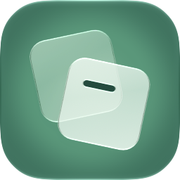
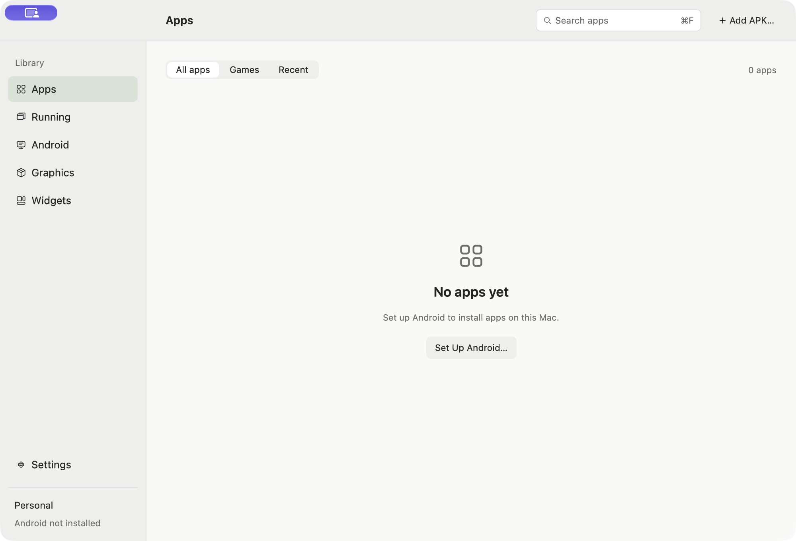

<p align="center">
  <picture>
    <source media="(prefers-color-scheme: dark)" srcset="assets/brand/glidepod-icon-dark.png">
    
  </picture>
</p>

<h1 align="center">GlidePod</h1>

<p align="center">Android apps, in their own Mac windows.</p>

<p align="center">
  <a href="LICENSE"></a>
  
  
</p>

<p align="center">
  <a href="#what-works-today">Features</a> ·
  <a href="#build-from-source">Build</a> ·
  <a href=".agents/development/runtime.md">Runtime setup</a> ·
  <a href=".agents/README.md">Engineering notes</a> ·
  <a href="CONTRIBUTING.md">Contribute</a>
</p>

GlidePod is an open-source Android environment for Apple Silicon Macs, built with **Rust, GPUI and Cuttlefish ARM64 guests**. Install an APK, open it in a separate macOS window, and manage its storage, permissions and runtime from one place.

> [!IMPORTANT]
> **Developer preview.** The management app and guest integration are implemented, but a runtime must be prepared separately. There is no ready-to-install, notarized release or bundled Android image yet. Broad game compatibility and production reliability remain unqualified.

## What works today

| Area | Current implementation |
| --- | --- |
| **Apps** | APK install, update and removal; searchable catalog; APK file association; per-user Mac launcher bundles. |
| **Windows** | Independent Android displays and GPUI windows, with separate frame and input workers per app. |
| **Input** | Unicode text and clipboard, held keyboard events, touch/mouse modes, two-contact gestures and native GameController mapping. |
| **Management** | Developer VM start/stop and resources; app storage, cache/data cleanup and Android runtime permissions. |
| **Desktop integration** | Live Android widget panels and opt-in notification forwarding. Native WidgetKit support is still planned. |
| **Graphics** | Software baseline and an experimental gfxstream → MoltenVK → Metal path; dedicated GLES 3 and Vulkan correctness/performance fixtures. |

Real guest checks have exercised app lifecycle, independent displays/input, storage, permissions, GLES 3 and direct Vulkan. Physical keyboard/IME, mouse and controller behavior, current native notification interactions, Launchpad indexing and end-to-end presentation latency still need broader on-device validation. See the [implementation records](.agents/README.md) for the scope of each result.

<details>
<summary><strong>Native management center preview</strong></summary>

<p align="center"></p>

An actual capture of the early native GPUI management center, before a runtime was registered. The purple badge in the title bar belongs to the capture session. This is not a screenshot of Android apps running in separate windows. The separate [interactive browser prototype](.agents/prototype/README.md) is a simulated design reference.

</details>

## How it works

The Android guest runs under an external Rust VMM using Apple's Hypervisor.framework. GlidePod owns the app catalog, lifecycle, per-app displays and macOS windows. Cuttlefish supplies the Android guest; its Linux host launcher is not the macOS runtime.

```text
Android app
  ├─ OpenGL ES → guest ANGLE ─┐
  └─ Vulkan ─────────────────┴─→ gfxstream → MoltenVK → Metal
                                  │
                            frame readback
                                  ↓
                         per-app GPUI window
```

The current transport reads frames back to the host. Shared IOSurface presentation is planned. GPUI renders the Mac interface; the separate guest graphics stack accelerates Android. **Automatic currently uses Software**; Metal requires an explicitly registered, patched external renderer. See [runtime setup](.agents/development/runtime.md) and the [graphics design](.agents/research/03-graphics-and-games.md).

## Build from source

Development currently requires **Apple Silicon, Xcode 27, Rust and Python 3.12+**. Validation has used macOS 27.0.1 and Rust 1.99.1. The configured macOS 15 deployment target and Rust 1.90 minimum still need separate validation.

```sh
git clone https://github.com/backrunner/glidepod.git
cd glidepod
python3 tools/prepare-android-tools.py
cargo fetch --locked --target aarch64-apple-darwin
python3 tools/license-inventory.py
python3 tools/package-dev.py
open dist/GlidePod.app
```

This produces a local, ad-hoc signed development app. It downloads compile tools into `.cache/` and builds the original Android helpers; it does not install an Android system image. Follow the **[build guide](.agents/development/building.md)** for checks and prerequisites, then **[prepare the runtime](.agents/development/runtime.md)** to run APKs.

The management center can be explored without a guest. `⌘O` opens an APK, `⌘F` focuses search and `⌘R` refreshes. The companion CLI is available at `dist/GlidePod.app/Contents/MacOS/glidepodctl`; use `--help` to see commands.

## Next milestones

- A reproducible, redistributable runtime and a rootless Personal image.
- Async block I/O and better frame pacing, with persistence and scheduling tests.
- Lower-copy presentation and sustained GPU/game measurements.
- Broader physical input, accessibility and native notification validation.
- Native WidgetKit integration, signed/notarized downloads and a wider macOS test matrix.

Relative mouse capture, controller rumble and multiple players are also pending. Google Play services, DRM-dependent apps, anti-cheat compatibility and x86 Android translation are not provided. Advertised API versions and passing synthetic checks are not graphics conformance or game certification.

## Explore the project

- **[Architecture and research](.agents/README.md)** — decisions, references and the interactive design prototype.
- **[Independent windows and input](.agents/implementation/05-independent-windows-and-input.md)** — display ownership, input routing and acceptance boundaries.
- **[GLES 3](.agents/implementation/07-gles3-metal.md)** and **[Vulkan](.agents/implementation/08-native-vulkan.md)** — original workloads, renderer patch and measured limits.
- **[Frame pacing investigation](.agents/implementation/09-vulkan-frame-pacing.md)** — what the traces establish and what remains unresolved.
- **[Icon source](assets/README.md)** — the editable layered package mark in Icon Composer.
- **[Contributing](CONTRIBUTING.md)** — build checks, evidence expectations and dependency policy.

## License

Original GlidePod code, documentation and artwork are licensed under **[Apache-2.0](LICENSE)**. It permits use, modification and redistribution, including commercial use, and includes an express contributor patent grant under its terms.

Dependencies keep their own licenses. See [NOTICE](NOTICE), [third-party notices](THIRD_PARTY_NOTICES.md) and the [dependency inventory](licenses/dependency-inventory.json). External VMM/renderer binaries, Android images, SDK archives and third-party APKs are not included in this source repository. Binary distribution requires a separate component and notice review.

GlidePod is an independent project and is not affiliated with Apple, Google or the Android Open Source Project.
